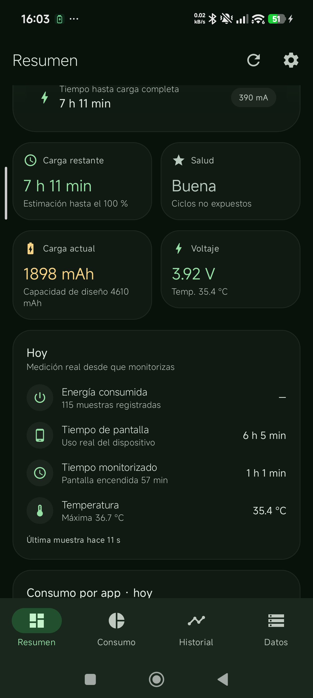
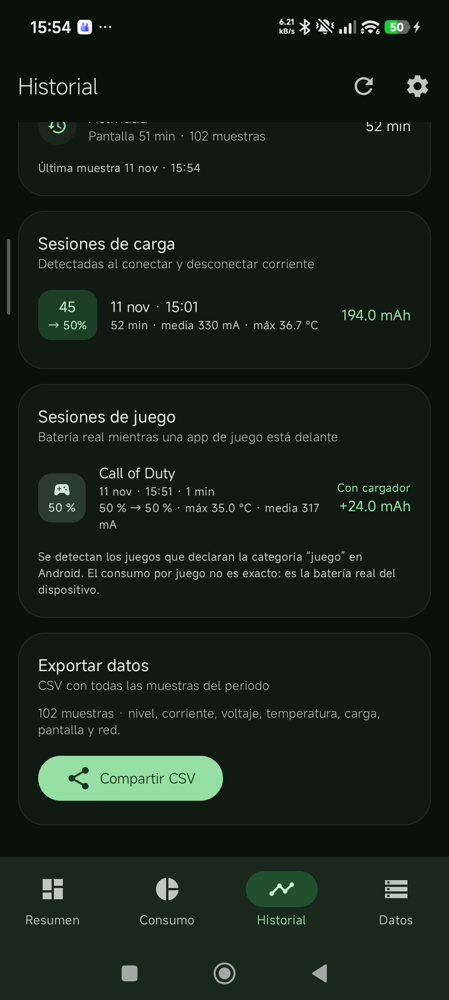
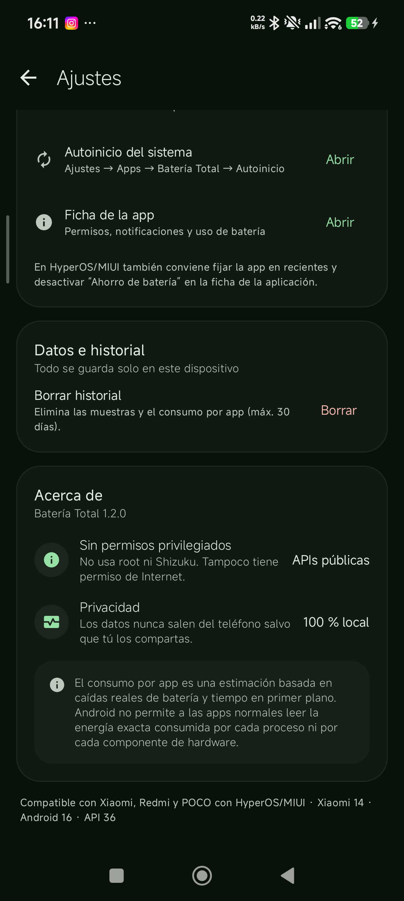

# Batería Total

[](LICENSE)
[](https://developer.android.com)
[](https://kotlinlang.org)

App Android en español para **Xiaomi, Redmi y POCO con HyperOS o MIUI** (y para
cualquier Android 8.0+) que muestra la mayor cantidad posible de datos de
batería, consumo y estado del hardware usando **solo APIs públicas**, sin root,
sin Shizuku y sin permisos privilegiados.

- Paquete: `com.batteriatotal`
- Versión: `1.2.0` (versionCode 3)
- `minSdk 26` · `targetSdk 35` · `compileSdk 35`
- Kotlin + Jetpack Compose (Material 3)
- **Sin permiso de Internet**: todos los datos se quedan en el teléfono.
- Repositorio: <https://github.com/christianeha92-droid/BateriaTotal>

## APK listo para instalar

[**Descargar el APK 1.2.0 desde GitHub Releases**](https://github.com/christianeha92-droid/BateriaTotal/releases/latest)

También puedes compilarlo desde el código. El APK local se llama
`BateriaTotal-1.2.0-debug.apk` y queda en `app/build/outputs/apk/debug/app-debug.apk`.
Está firmado con la clave de depuración de Android (APK Signature Scheme v2),
por lo que es instalable directamente, pero no sirve para publicar en Google Play.

### Instalar por ADB

```bash
adb install -r BateriaTotal-1.2.0-debug.apk
```

En HyperOS/MIUI activa antes **Ajustes → Ajustes adicionales → Opciones de
desarrollador → Depuración USB** y, si aparece el aviso, **Instalar vía USB**.
También puedes copiar el APK al teléfono y abrirlo con el explorador de archivos.

## Compatibilidad con HyperOS y MIUI

La app está pensada para la familia Xiaomi (Xiaomi, Redmi y POCO) y funciona
también en Android estándar. No depende de una única versión de HyperOS:

- Las pantallas de **Autoinicio**, **Opciones de carga** y **Game Turbo** se
  buscan primero entre componentes conocidos y, si Xiaomi cambia el nombre en
  otra versión, se buscan actividades exportadas de `com.miui.securitycenter` y
  `com.miui.securityadd`. Si no aparecen, se abre la ficha de la app y se indica
  la ruta manual.
- La capacidad de la batería se intenta leer de
  `/sys/class/power_supply`. Si HyperOS la bloquea, se usan valores conocidos
  para la familia Xiaomi 14 y, para el resto de modelos, un valor genérico de
  **5000 mAh** que puedes cambiar en Ajustes.
- El modo juego usa `UsageStatsManager` y la categoría pública
  `ApplicationInfo.CATEGORY_GAME`. Funciona igual en HyperOS 1.x, 2.x y 3.x.
- No se usan listas privadas de Game Turbo ni APIs ocultas: si un juego no se
  declara como tal, no se detectará automáticamente.

| Dispositivo / sistema | Estado |
| --- | --- |
| Xiaomi 14 (`houji`), HyperOS 3 / Android 16 | Probado en hardware real |
| Otros Xiaomi, Redmi y POCO con HyperOS 1.x, 2.x o 3.x | Rutas conocidas + búsqueda dinámica; pendiente de probar en hardware |
| Xiaomi/Redmi con MIUI 12 o posterior | Rutas conocidas + búsqueda dinámica; pendiente de probar en hardware |
| Android estándar 8.0+ | Funciona sin las pantallas específicas de HyperOS/MIUI |

## Capturas

<p align="center">
  
  
  
</p>

## Primer arranque en HyperOS/MIUI

La app abre una tarjeta de configuración en **Resumen** y tiene una pantalla de
**Ajustes**. Para que el historial y el reparto por app funcionen de verdad:

1. **Notificaciones**: permite las notificaciones de Batería Total. El servicio
   de monitorización las usa para seguir activo en segundo plano.
2. **Acceso de uso**: Ajustes → Privacidad → Permisos especiales → Acceso de uso
   → Batería Total → Permitir. Sin esto Android no deja saber qué app está en
   primer plano; el resto de datos sigue funcionando.
3. **Sin restricciones de batería**: Ajustes → Apps → Batería Total → Ahorro de
   batería → **Sin restricciones**.
4. **Autoinicio**: Ajustes → Apps → Batería Total → **Autoinicio** activado.
   Así el monitor se reanuda tras reiniciar el móvil.
5. Recomendado: en Recientes, mantén la tarjeta de Batería Total fijada
   (candado) y desactiva cualquier opción de "pausar actividad de apps si no se
   usan" para esta app.

La app intenta abrir directamente las pantallas de Autoinicio y de optimización
de batería de HyperOS/MIUI. Si Xiaomi cambia la actividad del sistema, abre la
ficha de la app como alternativa; la ruta manual está indicada arriba.

## Qué muestra

### Resumen
- Nivel, estado de carga, fuente de alimentación, salud declarada, tecnología.
- Voltaje, temperatura, corriente instantánea/media, potencia calculada.
- Contador de carga real (`charge_counter`) y capacidad restante estimada.
- Autonomía / tiempo hasta carga completa (estimación).
- Energía consumida hoy, tiempo de pantalla, tiempo monitorizado y temperatura.
- Top de apps por consumo atribuido y estado del hardware en tiempo real.

### Consumo
- Periodos: hoy, últimas 24 h y últimos 7 días.
- Reparto entre apps y "sistema/reposo".
- Tiempo en primer plano, aperturas y última vez usada por app.
- Pestaña **Hardware**: corriente media medida con pantalla encendida/apagada,
  con WiFi, con datos móviles y sin red. Son mediciones reales de la batería
  agrupadas por estado del sistema, no vatios inventados por componente.

### Historial
- Gráficas de nivel, corriente, temperatura y voltaje (6 h, 24 h, 7 días).
- Detección de sesiones de carga: duración, nivel ganado, energía añadida y
  temperatura máxima.
- **Sesiones de juego**: duración, batería inicial/final, temperatura máxima,
  corriente media, si hubo cargador y aviso si la batería bajó estando enchufado.
- Exportación CSV de todas las muestras mediante el selector de compartir.

### Datos
- Todas las propiedades públicas de `BatteryManager`.
- **Todos** los extras de `ACTION_BATTERY_CHANGED`, incluidas claves propias de
  Xiaomi/HyperOS si el sistema las publica.
- Identificación del dispositivo, versión de HyperOS/MIUI, SoC, ABI, parche de
  seguridad y `getprop` seleccionado.
- Lectura best-effort de `/sys/class/power_supply` (a menudo bloqueada por
  SELinux) y listado de sensores con su potencia declarada.
- Informe de texto completo para compartir.

### Ajustes
- Activar/pausar el monitor.
- **Modo juego**: detecta juegos en primer plano, registra la partida y avisa
  cuando el cargador no cubre el consumo. Incluye accesos directos a
  **Opciones de carga** y **Game Turbo** de HyperOS/MIUI.
- Frecuencia de muestreo con pantalla encendida (15 s a 5 min).
- Capacidad de diseño editable; se detecta de `/sys` cuando es posible y se usan
  valores conocidos o un valor genérico cuando HyperOS la bloquea.
- Tema sistema/claro/oscuro.
- Accesos directos a permisos, optimización de batería y autoinicio.
- Borrado del historial.

## Cómo se calcula el consumo

Android **no expone a las apps normales** la energía exacta consumida por cada
proceso ni por cada componente (CPU, pantalla, radios). Lo que sí se puede leer
son el nivel, el contador de carga, la corriente, el voltaje, la temperatura y
los eventos de uso.

- **Consumo total**: diferencia del contador de carga (`charge_counter`, µAh)
  entre muestras; si no está disponible, se estima con la caída de nivel y la
  capacidad de diseño.
- **Consumo por app**: cuando se detecta una caída real de batería, se reparte
  proporcionalmente al tiempo que cada app estuvo en primer plano dentro del
  intervalo. La parte sin app en pantalla queda como sistema/reposo. Por eso la
  UI lo etiqueta siempre como **estimación**.
- **Consumo por estado**: corriente media derivada de las caídas reales,
  agrupada por pantalla encendida/apagada y por tipo de red.
- **mAh**: se derivan del contador de carga cuando existe. La capacidad de
  diseño solo se usa como respaldo y para calcular porcentajes.

El monitor guarda una muestra cada **30 s** con la pantalla encendida y cada
**5 min** con la pantalla apagada. Android Doze puede espaciar aún más las
muestras en reposo. El historial se conserva **30 días** y se borra solo.

## Modo juego: qué hace y qué no puede hacer

El modo juego usa `UsageStatsManager` para saber qué app está en primer plano y
`ApplicationInfo.category == CATEGORY_GAME` para reconocer juegos. Necesita el
**acceso de uso** y el monitor activo. No usa listas privadas de Game Turbo:
los juegos que no declaren la categoría "juego" no se detectan.

Mientras una partida está activa, la app:

- Guarda en SQLite la duración, el nivel inicial/final, el contador de carga, la
  temperatura mínima/máxima y la corriente media/máxima.
- Muestra una notificación con batería, temperatura y estado del cargador, con
  botones para abrir **Opciones de carga** y **Game Turbo**.
- Si detecta que la batería baja mientras el cargador está conectado (caída del
  contador o estado de descarga), muestra un aviso de **cargador insuficiente**.

**Lo que no puede hacer:** elegir la fuente de energía. Esa decisión es del
controlador de carga (PMIC) y del firmware; Android no expone una API pública
para forzar que el sistema use el cargador en lugar de la batería. La función
"carga inteligente"/bypass de HyperOS/MIUI se activa sola en los modelos que la
soportan y no tiene un interruptor público. Un interruptor en la app sería
decorativo, así que no se ha incluido.

## Compilar desde el código

Requisitos: JDK 17 o superior, Android SDK con plataforma 35 y build-tools 35.

```bash
git clone https://github.com/christianeha92-droid/BateriaTotal.git
cd BateriaTotal
echo "sdk.dir=/ruta/a/Android/Sdk" > local.properties
./gradlew assembleDebug
```

El wrapper usa Gradle 8.9. El APK resultante queda en:

```
app/build/outputs/apk/debug/app-debug.apk
```

También se puede abrir el proyecto directamente en Android Studio (Ladybug o
posterior). No hay dependencias nativas ni servicios externos.

## Estructura

```
app/src/main/java/com/batteriatotal/
├── BatteryApp.kt              Application, canales y notificaciones
├── MainActivity.kt            Entrada Compose y ciclo de vida
├── data/                      Lectura de batería, SQLite, análisis, permisos,
│                              HyperOS/MIUI, perfiles de dispositivo, sensores,
│                              sysfs, exportación y formato
├── monitor/                   Servicio en primer plano, modo juego y arranque
└── ui/                        ViewModel, navegación, tema, pantallas y componentes
```

## Limitaciones honestas

- No hay desglose real de vatios por CPU/pantalla/radio: es información
  privilegiada del sistema. La app muestra el consumo total medido y la
  corriente media por estado del hardware.
- La salud exacta y el SoH de la batería no están disponibles por API pública en
  HyperOS/MIUI; se muestra la salud declarada por Android y los ciclos solo si el
  fabricante los publica.
- HyperOS/MIUI puede bloquear `/sys/class/power_supply`; en ese caso la sección
  del kernel aparece como no accesible y la capacidad se estima.
- El reparto por app y el modo juego necesitan el acceso de uso y dependen de que
  el servicio siga vivo. HyperOS/MIUI puede detenerlo si no se configuran
  autoinicio y batería sin restricciones.
- El modo juego solo reconoce apps que se declaren como juego. No puede leer la
  lista privada de Game Turbo ni controlar la fuente de alimentación.
- Las pantallas de Autoinicio, Carga y Game Turbo cambian entre versiones de
  HyperOS/MIUI. La app prueba varias rutas y, si ninguna existe, abre la ficha de
  la app para que puedas llegar manualmente.
- El APK está firmado en modo debug. El proyecto compila sin errores, pasa
  `lintDebug` con 0 errores y la firma v2 está verificada.

## Verificado en un Xiaomi 14 real

Las versiones 1.1.0 y 1.2.0 se instalaron y probaron en un **Xiaomi 14
(`23127PN0CG`, `houji`)** con HyperOS `OS3.0` / Android 16:

- Instalación y actualización por ADB correctas (`versionCode 3`, `versionName
  1.2.0`).
- El servicio en primer plano arranca y mantiene su notificación de monitor.
- El modo juego detectó **Call of Duty** (`com.activision.callofduty.shooter`):
  mostró la notificación `Modo juego · Call of Duty` con batería, temperatura y
  corriente, y al cerrar el juego la sesión quedó finalizada y visible en
  **Historial → Sesiones de juego**.
- **Opciones de carga** abre `com.miui.powercenter.charge.ChargeFeatureActivity`.
- **Game Turbo** abre
  `com.miui.securityadd/com.miui.gamebooster.GameBoosterRichWebActivity`.
- **Autoinicio del sistema** abre
  `com.miui.securitycenter/com.miui.permcenter.autostart.AutoStartManagementActivity`.
- La capacidad del Xiaomi 14 se muestra como 4610 mAh sin configuración manual.
- En esta prueba los permisos de uso, notificaciones y exclusión de batería se
  concedieron por ADB para agilizar la verificación. En un uso normal se
  conceden desde la propia app o desde Ajustes; el **autoinicio** de HyperOS
  sigue teniendo que activarse a mano porque este dispositivo no expone el op
  `AUTO_START`.

## Licencia

Este proyecto se distribuye bajo la licencia **MIT**. Consulta el archivo
[`LICENSE`](LICENSE).
